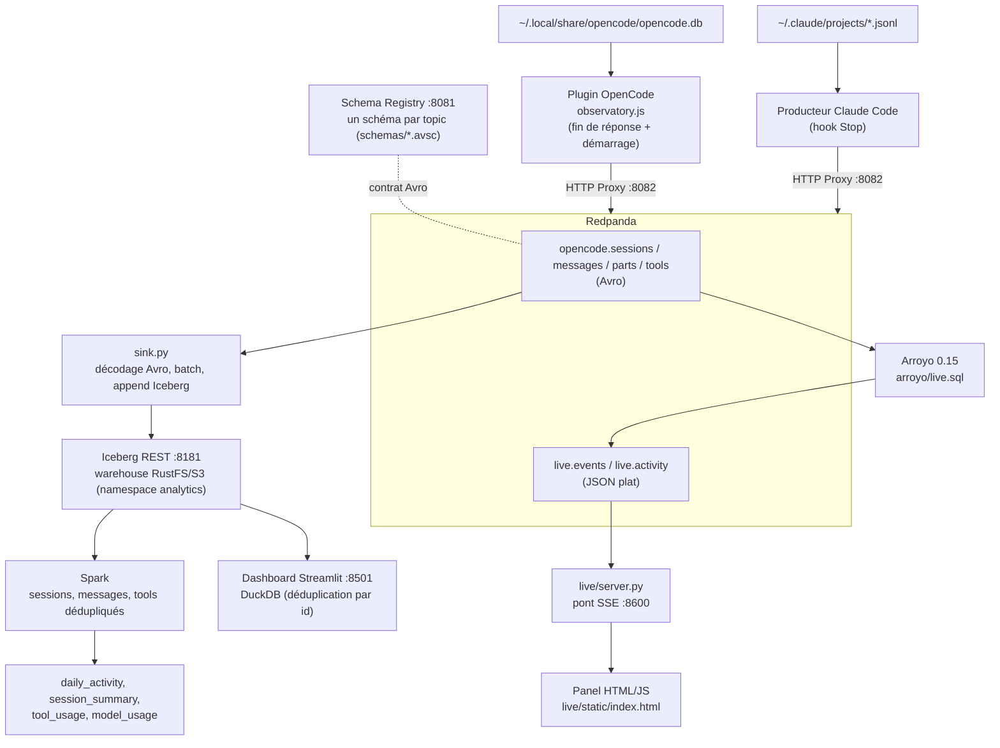
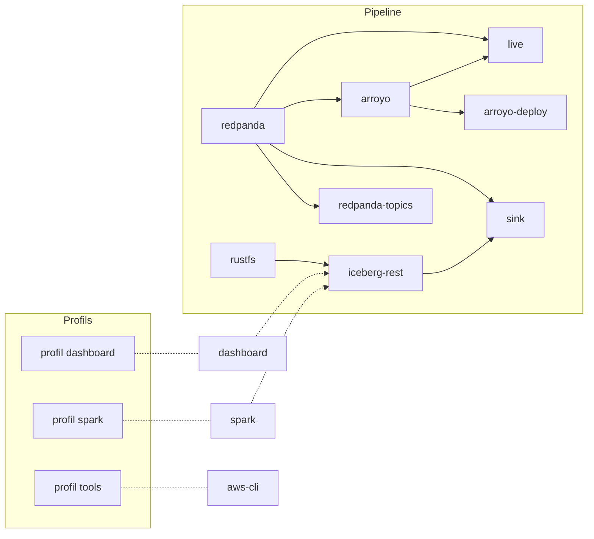

# Architecture et flux

## Flux principal

Spark ne lit pas la table `parts`. Le dashboard, lui, charge les quatre tables.
Le chemin temps réel (Arroyo → `live.*` → panel) est détaillé dans
[realtime.md](realtime.md).

## Pourquoi cette forme

- Redpanda découple l'extraction locale de l'écriture des tables : le
  producteur ne fait que publier des événements, le sink avance à son rythme.
- Le producteur vit dans OpenCode : il publie au moment où une réponse se
  termine, sans polling. Il passe par le HTTP Proxy de Redpanda, ce qui évite
  d'embarquer un client Kafka dans le runtime JavaScript d'OpenCode.
- Le Schema Registry matérialise le contrat entre producteur et sink : un
  événement qui ne respecte pas le schéma Avro est refusé à la production.
- Iceberg est la seule source de vérité lue par le dashboard : le stockage S3
  est atteint *via* le catalogue, ce qui garantit des snapshots cohérents.
- Comme le sink fait de l'append en au-moins-une-fois, chaque lecteur garde la
  version la plus récente de chaque ligne (`updated_at` décroissant).

## Services Docker

`docker-compose.yml` définit onze services :

- `redpanda` expose le protocole Kafka sur `localhost:9092` (hôte) et
  `redpanda:29092` (réseau Compose), son Schema Registry sur
  `localhost:8081` / `redpanda:8081` et son HTTP Proxy sur `localhost:8082`.
- `redpanda-topics` crée les quatre topics `opencode.*` et les deux topics
  `live.*` au démarrage puis s'arrête.
- `rustfs` expose l'API S3 sur `localhost:9000` et sa console sur
  `localhost:9001`.
- `iceberg-rest` expose le catalogue Iceberg sur `localhost:8181` et utilise
  RustFS comme warehouse. Son catalogue SQLite est persisté dans le volume
  `iceberg-catalog`.
- `sink` consomme les topics et alimente Iceberg en continu.
- `arroyo` (moteur de streaming, UI sur `localhost:5115`) fait tourner les
  pipelines temps réel ; ses données sont dans le volume `arroyo-data`.
- `arroyo-deploy` est un one-shot qui enregistre les `arroyo/*.sql`.
- `live` est le pont SSE et le panel, sur `localhost:8600`.
- `dashboard` est activé par le profil Docker `dashboard` et écoute sur
  `localhost:8501`.
- `spark` est activé par le profil `spark` et exécute `spark/analytics.py`.
- `aws-cli` est un outil ponctuel, activé par le profil `tools`, pour interagir
  avec l'API S3 de RustFS.

Les volumes Docker persistent les objets RustFS (`rustfs-data`), les logs
Redpanda et le Schema Registry (`redpanda-data`), le catalogue Iceberg
(`iceberg-catalog`) et l'état d'Arroyo (`arroyo-data`). Les ports sont liés à
`127.0.0.1` par défaut afin de ne pas publier les services sur le réseau local.

## Modes de lecture du dashboard

Le dashboard scanne les tables Iceberg du catalogue (`ICEBERG_CATALOG_URI`),
les enregistre dans DuckDB sous `raw_sessions`, `raw_messages`,
`raw_parts` et `raw_tools`, puis crée des vues dédupliquées `sessions`,
`messages`, `parts` et `tools`. Il n'y a plus de repli Parquet local : sans
Iceberg, le dashboard affiche une erreur qui rappelle les étapes du pipeline.

## Synchronisation continue

Le plugin `plugins/opencode/observatory.js` publie dès qu'une réponse de
l'agent se termine, et au démarrage d'OpenCode pour rattraper ce qui aurait
été manqué. Le watermark
par dataset est persisté dans `PRODUCER_STATE_FILE` ; l'état d'avancement de
l'écriture Iceberg est, lui, l'offset Kafka du groupe
`KAFKA_CONSUMER_GROUP`.
